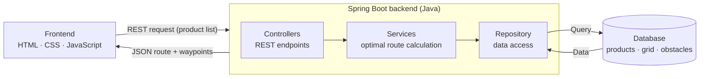

# AisleWise: Supermarket Navigation Web Application

> *Fresh groceries, found aisle by aisle.*

**AisleWise** is a web application that guides shoppers through a supermarket. The shopper enters a product list, and AisleWise calculates an **optimal route** through the store, shows it on an interactive map, and displays each item's stock availability and price. The long-term goal is to run the app on a screen embedded in the supermarket's shopping carts.

Built by **Team Apocalypse**.

---

## Table of Contents

1. [Problem Domain](#problem-domain)
2. [Our Solution](#our-solution)
3. [Objectives](#objectives)
4. [Surveys](#surveys)
5. [Features](#features)
6. [System Architecture](#system-architecture)
7. [Optimal Route Calculation](#optimal-route-calculation)
8. [Database and Store Layout](#database-and-store-layout)
9. [Tech Stack](#tech-stack)
10. [Project Structure](#project-structure)
11. [Getting Started](#getting-started)
12. [Hardware Deployment](#hardware-deployment)
13. [Challenges We Faced](#challenges-we-faced)
14. [Project Status](#project-status)
15. [Team and Contributors](#team-and-contributors)
16. [Acknowledgements](#acknowledgements)

---

## Problem Domain

One of the main problems consumers face in a supermarket is **finding the location of a specific product** inside the store.

As a first step, we visited a nearby supermarket (**KEELS Katubedda**) and investigated the problem. From an inquiry with a staff member, we concluded that **about 75% of customers keep asking about product locations**. We then ran a survey to ask consumers about this problem worldwide.

## Our Solution

A web application that:

- provides the **route through the supermarket** based on the products the user enters,
- shows **stock availability and price** for each product, and
- is designed to be **deployed on screens fixed to the supermarket carts**.

## Objectives

| # | Objective | What it means |
|---|-----------|---------------|
| 1 | **Faster shopping trips** | Guides shoppers along an optimal route to checkout, cutting time spent wandering aisles |
| 2 | **Precise product guidance** | Pinpoints each item's exact aisle, shelf and column so shoppers walk straight to it |
| 3 | **Reduced in-store congestion** | Smoother, more predictable foot traffic eases crowding in narrow aisles at peak hours |
| 4 | **Higher customer satisfaction** | A frictionless, low-stress shopping experience builds loyalty and repeat visits |

## Surveys

We conducted two surveys to understand the problem:

- **Physical survey:** a visit to KEELS Katubedda to observe the shopping experience and speak to a staff member.
- **Online survey:** shared worldwide to ask consumers about the same problem: https://tally.so/r/OD6L6R

<!-- TODO: add number of responses and key findings -->

## Features

- Browse **10 product categories** (22 items each): vegetables, fruits, dairy, meat, seafood, bakery, pantry and baking, cereals, snacks and beverages
- **Search** for items and add them to a cart
- Product cards with **price per kg**, discount badges and add-to-cart buttons
- **Interactive store map** showing the optimal route from the entrance and carts to the checkout, with product pins
- **QR code** for continuing navigation on a mobile device
- **Download blueprint (PNG)** of the route map
- Stock availability and price details for each product

## System Architecture

The frontend communicates with a Spring Boot backend over REST. The backend calculates the route and reads product and layout data from the database.



**Request flow**

1. The shopper enters a product list in the frontend.
2. The frontend sends the list to the backend as a REST request.
3. The backend looks up each product's grid coordinates and calculates the optimal route.
4. The route is returned as JSON waypoints.
5. The frontend draws the route on the interactive map and shows a QR code for mobile navigation.

## Optimal Route Calculation

Route calculation uses a **Dijkstra + TSP approach**, implemented in `RouteSolverService`:

1. **Input:** the product list is converted to grid coordinates.
2. **Dijkstra:** computes the travel cost between every pair of stops on the walkable grid, going around obstacles (aisles and shelves).
3. **TSP (Travelling Salesman Problem):** chooses the best order in which to visit all the products.
4. **Route:** the final route (entrance, products, checkout) is returned as an ordered list of waypoints.

Dijkstra on its own is a greedy approach. Combining it with TSP makes the full route both **efficient and accurate**.

## Database and Store Layout

- The supermarket floor plan is divided into an **x-y coordinate grid** (x runs across the store from 0 to 23).
- The entrance, cart and checkout area is `y = 0`; shelf rows are counted upward from `y = 1`.
- Carts and the machine start at the store entrance.
- **Obstacles:** aisles and shelves are named and marked as non-walkable cells so the route never cuts through shelving:

| Aisle | Contents |
|-------|----------|
| Aisle 1 | Dairy & Milk |
| Aisle 2 | Bakery & Buns |
| Aisle 3 | Produce & Veg |
| Aisle 4 | Snacks & Sweets |
| Aisle 5 | Meat & Poultry |
| Aisle 6 | Seafood & Fish |

- **Products:** 10 categories with 22 items each. Every product is stored with its name, category, price, stock and its position on the grid (aisle, shelf and column).

## Tech Stack

| Layer | Technologies |
|-------|--------------|
| Frontend | HTML, CSS, JavaScript |
| Backend | Java, Spring Boot, Maven, REST (JSON) |
| Database | MySQL, SQLite, Python |
| Hardware | Screen embedded in the shopping cart |

## Project Structure

```
Store-Navigating-WebApp/
├── Backend/                          # Spring Boot application
│   ├── .mvn/
│   └── src/main/
│       ├── java/com/example/storenav.../
│       │   ├── controller/
│       │   │   ├── CartValidationController.java
│       │   │   ├── NavigationRouteController.java
│       │   │   ├── ProductCatalogController.java
│       │   │   └── SessionSyncController.java
│       │   ├── model/
│       │   │   ├── GridPoint.java
│       │   │   ├── PathNode.java
│       │   │   ├── Product.java
│       │   │   └── RouteResponsedto.java
│       │   ├── repository/
│       │   │   └── ProductRepository.java
│       │   ├── service/
│       │   │   ├── ProductCatalogService.java
│       │   │   ├── QRCodeSessionService.java
│       │   │   ├── RouteSolverService.java
│       │   │   └── StoreNavigationService.java
│       │   └── StoreNavigatingBackendApplication.java
│       └── resources/
└── Frontend/
    ├── index.html                    # Home, categories and products
    └── map.html                      # Interactive route map
```

| Layer | Responsibility |
|-------|----------------|
| Controllers | REST endpoints: product catalog, navigation route, cart validation, session sync |
| Services | Business logic, including optimal route calculation and QR code sessions |
| Models | Data objects such as `GridPoint`, `PathNode`, `Product` and the route response |
| Repository | Data access for products |

## Getting Started

> **Note:** these are general instructions. Adjust the ports, database settings and file paths to match your setup.

### Prerequisites

- Java (JDK) and Maven (or the included Maven wrapper)
- MySQL (and/or SQLite), configured as described in the backend's `application.properties`
- A simple static server for the frontend (for example, the VS Code *Live Server* extension)

### 1. Clone the repository

```bash
git clone https://github.com/Aki-2006-cmd/Store-Navigating-WebApp.git
cd Store-Navigating-WebApp
```

### 2. Set up the database

Create the database and load the store layout (grid coordinates, obstacles) and the product data. Then update the connection settings in `Backend/src/main/resources/application.properties`.

### 3. Run the backend

```bash
cd Backend
./mvnw spring-boot:run
```

### 4. Run the frontend

Open `Frontend/index.html` with a static server (for example, VS Code Live Server, which serves it at `http://127.0.0.1:5500/Frontend/index.html`). Make sure the frontend's API base URL points at your running backend.

## Hardware Deployment

The application is intended to run on a **screen embedded in the shopping cart**, so shoppers receive route guidance as they walk through the store. The hardware work was led by **H.A.V.N. Wijerathna** and **K.M.V.A. Karunanayake**.

## Challenges We Faced

1. **Greedy routing:** Dijkstra alone is a greedy approach. Combining it with TSP made the route efficient and accurate.
2. **Coordinate mapping:** matching the store's grid coordinates to the route algorithm, while keeping aisles out of the walkable path.
3. **Route rendering:** showing the calculated route and waypoints on the frontend map in line with the store layout.

## Project Status

- [x] Frontend (home, categories, products, interactive map)
- [x] Backend (Spring Boot API and optimal route calculation)
- [x] Database (layout grid, obstacles, products)
- [x] Hardware: web app deployed on a cart-mounted screen
- [ ] Testing and debugging (remaining)

## Team and Contributors

**Team Apocalypse**

| Student ID | Name | Part |
|------------|------|------|
| 250321J | K.M.V.A. Karunanayake | Frontend, cart hardware |
| 250720G | H.A.V.N. Wijerathna | Frontend, cart hardware |
| 250548K | H.M.D.T. Samarasena | Database |
| 250658X | W.S.D. Tissera | Database |
| 250190E | G.D.P.A. Gamage | Backend |
| 250237G | T.M. Hasthimuni | Backend |
| 250655K | A. Thivaharan | Backend |

## Acknowledgements

With sincere thanks and credit to **Prof. Sanath Jayasena**.
